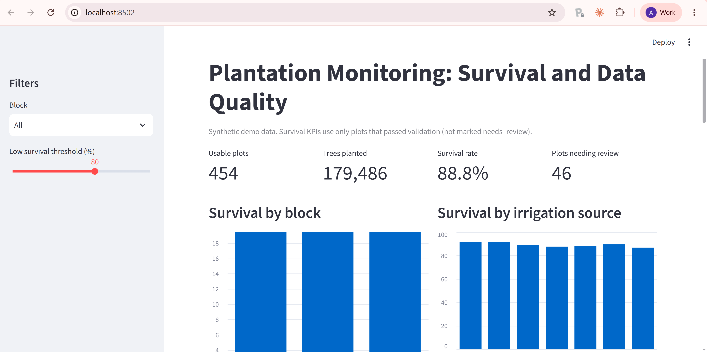
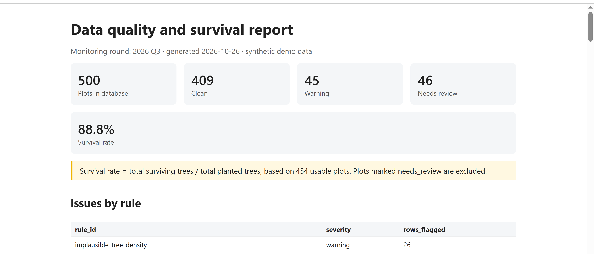

# MRV Data Pipeline

A configurable Python pipeline that validates, cleans and summarises plantation monitoring survey data for Measurement, Reporting and Verification (MRV) work. It ends in a SQL database and a dashboard showing tree survival KPIs.

> **Data note:** all data in this repository is synthetic. It is generated randomly to imitate the structure of a tree-plantation monitoring survey. It contains no real farmers, villages, projects or coordinates.


**[Live demo](https://mrv-data-pipeline-yfcj9elgrdc9hqer3otatt.streamlit.app/)** (synthetic data; the app may take a moment to wake up if it has been idle)


## Problem

Monitoring survey exports usually arrive with errors: planted area larger than the land parcel, more surviving trees than planted, species counts that do not add up, duplicate farmers, incomplete rows. Checking these by hand each monitoring round is slow, and different people check different things. Survival numbers calculated from unchecked data can be wrong.

## What this does

**Phase 1: Validation**
- Loads a survey export and maps its column names to a standard format (`config/column_mapping.yaml`)
- Runs validation rules defined in plain text (`config/rules.yaml`), so a rule can be added or changed without touching the code
- Produces a list of every problem found, with row number, farmer ID, rule, severity (fail or warning) and message
- Checks itself against an answer key of problems planted in the dummy data

**Phase 2: Cleaning and database**
- Fixes only safe problems (settings in `config/cleaning.yaml`) and records every change in an audit log
- Labels each row `clean`, `warning` or `needs_review`
- Stores plots, issues and the audit log in a SQLite database, with a `usable_plots` view that leaves out rows needing review

**Phase 3: KPIs and dashboard**
- Calculates survival KPIs with SQL from the `usable_plots` view
- Shows them in a Streamlit dashboard

## Results on the dummy dataset

**Validation (Phase 1)**

| Measure | Result |
|---|---|
| Rows checked | 506 |
| Rules | 9 (6 rule types) |
| Problems planted on purpose | 107 |
| Planted problems caught | 107 of 107 |
| Planted problems missed | 0 |
| Extra flags | 18 |

The 18 extra flags are all `implausible_tree_density`. They are rows where the planted area was inflated, so trees per hectare looks too low. One data error legitimately triggers two checks.

**Cleaning (Phase 2)**

| Measure | Result |
|---|---|
| Rows in / rows out | 506 / 500 |
| Issues before / after cleaning | 125 / 109 |
| Changes recorded in audit log | 16 |
| Rows marked clean | 409 |
| Rows marked warning | 45 |
| Rows marked needs_review | 46 |

**Tests:** 19 passing.

## Dashboard

A Streamlit dashboard shows plantation survival KPIs calculated with SQL from the cleaned database.

- Usable plots, trees planted, overall survival rate and the number of plots needing review
- Survival by block and by irrigation source
- Surviving trees by species (share of total)
- Data quality: plots by status (clean, warning, needs_review)
- A follow-up list of plots below a survival threshold you choose
- Validation issues counted by rule

Survival is calculated as total surviving trees divided by total planted trees. Plots marked `needs_review` are excluded from survival KPIs, so bad data does not distort the numbers.

## Data quality action centre

A second dashboard page lists every flagged record so the data team knows exactly what to correct.

- Filter by validation rule, severity and block
- See the farmer ID, row number, block, village, rule and message for each issue
- Download the filtered list as CSV or Excel, with `correction_status`, `corrected_value` and `notes` columns for the field team to fill in

Issues for rows removed during cleaning are kept in the list, with block and village shown as `n/a`.

## QA report

Each monitoring round can produce a standalone HTML report for the project team:

```bash
python -m src.make_report --round "2026 Q3"
```

The report is saved in `reports/` and contains:
- Plot counts by status (clean, warning, needs_review)
- Validation issues counted by rule
- The list of plots needing review, with the rules that flagged them, so field teams know what to re-check
- Survival by block and irrigation source, and plots below a survival threshold
- The changes made by the cleaning step



## Rule types

| Type | Checks |
|---|---|
| `compare` | One column against another (planted area must not exceed parcel area) |
| `sum_equals` | Columns must add up to a total (species counts equal total surviving) |
| `allowed_values` | Values must come from a list (irrigation source, gender format) |
| `not_null` | Required answers must not be blank |
| `ratio_range` | A ratio must fall in a range (trees per hectare) |
| `duplicate` | A value must not repeat (farmer ID) |

Example rule:

```yaml
- id: surviving_exceeds_planted
  type: compare
  left: trees_surviving
  operator: "<="
  right: trees_planted
  severity: fail
  message: Surviving trees are more than trees originally planted
```

## Project structure

```
mrv-data-pipeline/
├── config/
│   ├── column_mapping.yaml    standard column names for each survey export
│   ├── rules.yaml             validation rules
│   └── cleaning.yaml          cleaning settings
├── src/
│   ├── ingest.py              load CSV and rename columns
│   ├── validate.py            rule engine
│   ├── clean.py               safe fixes, audit log, row status
│   ├── load_db.py             write results to SQLite
│   ├── run_pipeline.py        run the full pipeline
│   ├── run_validation.py      run validation only and compare with the answer key
│   ├── kpis.py                SQL KPI queries
│   └── make_report.py         build the HTML QA report
├── dashboard/
│   ├── app.py                 Streamlit dashboard (main page)
│   └── pages/
│       └── 1_Data_quality.py  data quality action centre
├── tests/
│   ├── test_validate.py
│   ├── test_clean.py
│   ├── test_kpis.py
│   ├── test_report.py
│   └── test_action_centre.py
├── data/raw/                  synthetic data and answer key
├── docs/                      dashboard and report screenshots
└── reports/                   issue list, audit log and QA reports
```

## How to run

```bash
git clone https://github.com/angyisinluv/mrv-data-pipeline.git
cd mrv-data-pipeline
python -m venv venv
source venv/Scripts/activate      # Windows Git Bash (Mac/Linux: source venv/bin/activate)
pip install -r requirements.txt
python -m src.run_pipeline        # validate, clean, build the database
python -m pytest -q               # run the tests
streamlit run dashboard/app.py    # open the dashboard
```

The dashboard opens at http://localhost:8501. The pipeline creates `data/mrv.db`, `data/processed/plantation_clean.csv` and `reports/audit_log.csv`.

## Roadmap

- [x] Phase 1: configurable rule engine with tests
- [x] Phase 2: cleaning with an audit trail, and loading into a SQLite database
- [x] Phase 3: survival KPIs by block, species and irrigation, plus a dashboard
- [x] Phase 4: automated QA report for each monitoring round
- [ ] Phase 5 (optional): model to flag plots at risk of low survival

## Future work

- Survival trends across monitoring rounds (Q1 to Q3)
- Village and species drill-downs
- Farmer and land parcel tables, so one farmer can own several parcels
- Issue status tracking (open, corrected, verified), which needs a persistent database
- Map view, if real coordinates become available

## Tech stack

Python, pandas, PyYAML, SQLite, SQL, Streamlit, pytest

## Author

Angyllyn Gurung 